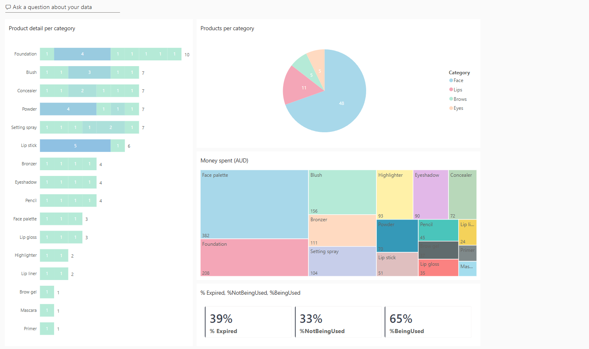
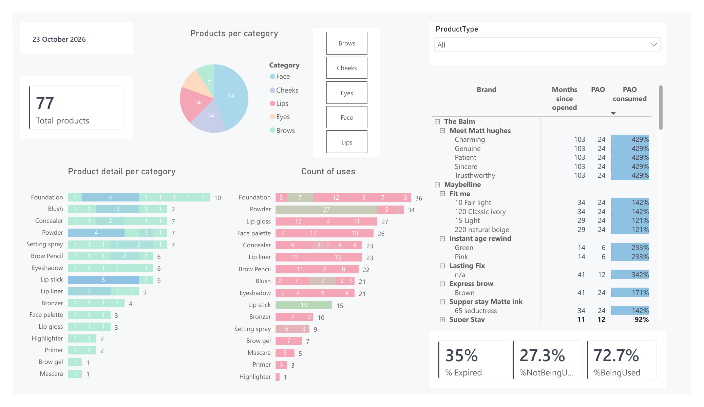
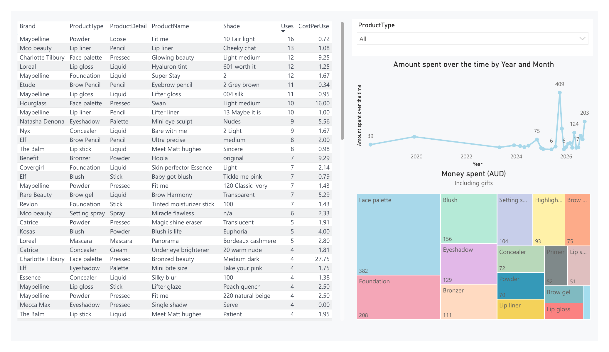
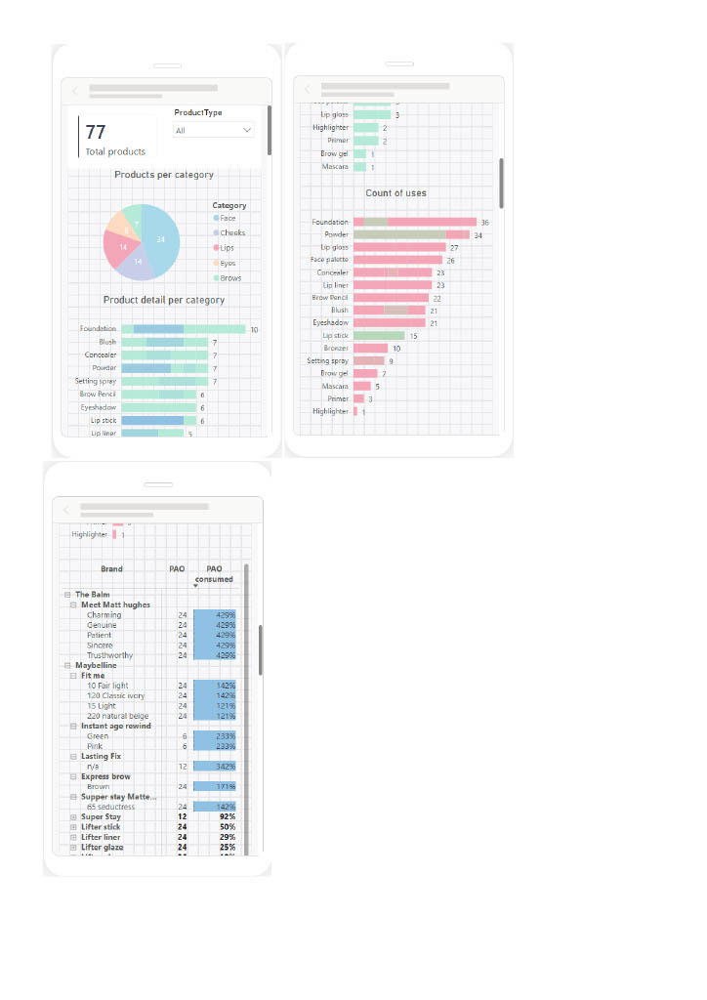
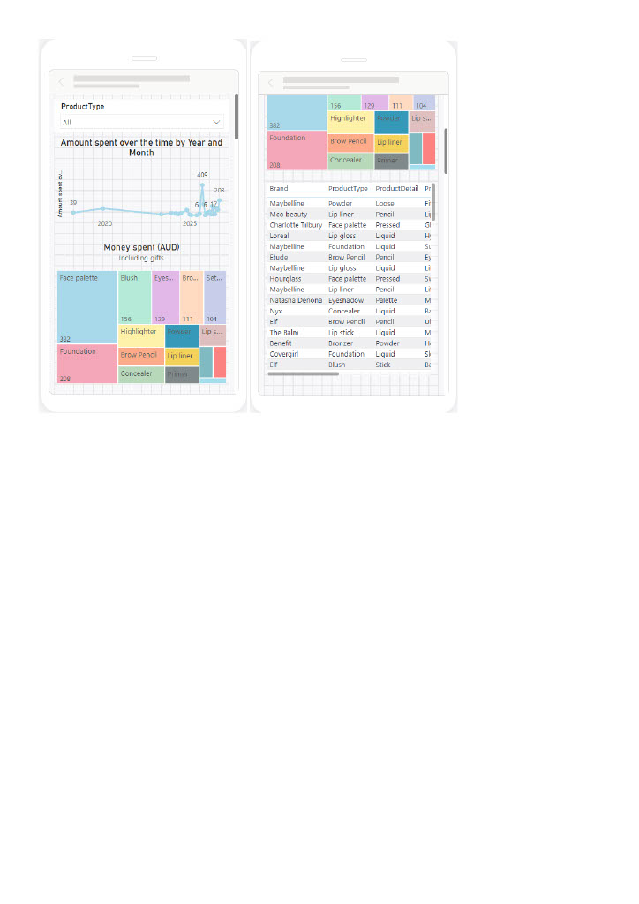

# Makeup Project Pan Tracker

A Power BI dashboard to track my makeup collection and help me buy less, use more, and spend smarter. Built on an Excel database that I update monthly regarding new purchases and product usage.

## Why I Built This

I created this project to help me to  reduce makeup overconsumption. Instead of guessing what I own or which products are worth repurchasing, I track each item’s usage, cost, and expiry date so every decision is based on data rather than impulse.

This system also highlights products approaching their expiry, allowing me to prioritize them and avoid unnecessary waste. It’s a practical way to understand what I truly use, value, and need — and to build a more intentional beauty routine.

## Conclusion
- I own sufficient makeup across all categories and do not need to purchase additional products. I also need to be especially mindful during the holiday season, as this period consistently triggers higher spending.

## Live Report
https://app.powerbi.com/groups/721013f9-cae4-406d-a3fb-1a88fdb620e8/dashboards/d10abfd6-a38a-4acc-8a01-cdef91eedb12?experience=power-bi

## Questions the Dashboard Answers
- How many products do I own, and how are they distributed across categories?
- Which products am I actively using, and which ones remain untouched?
- Which items deliver the best — and worst — cost per use?
- Which products are approaching expiry based on their PAO, so I can prioritize them?
- How is my spending distributed by category?
- How much of my makeup collection is being used, under‑used, or already expired?
- During which seasons do I tend to spend more, and when should I be more mindful of my purchasing habits?

## Key Insights

- I currently own 77 makeup products across face, cheeks, lips, brows, and eyes, with foundations being the product where I have the most units.
- 72.7% of my products are actively used, while 27.3% remain untouched.
- My most frequently used items are powders, foundations, and concealers, whereas highlighters and primers show the lowest usage, largely because their use varies more by season than by preference.
- The strongest cost‑per‑use performers are eyebrow pencils, setting powders, and lip liners, likely because these categories rotate less frequently compared to cheek and eye products.
- Products across all categories are approaching or past expiry, including both cream and powder formulas. The oldest items — matte liquid lipsticks, powder blushes, and powder bronzers — suggest I should prioritize finishing those first.
- Spending consistently peaks in Q4, driven by holiday releases and seasonal value sets.
- My highest spending category has been face palettes, though I expect these to show a favorable long‑term cost‑per‑use since they contain multiple powder products that can be used for a complete face of makeup.

## Data
- **Source:** personal Excel database, updated monthly with new purchases and usage counts.
- **File:** https://github.com/KarenGuerrero15/MakeupProjectPan/blob/main/Data/Project_Pan.xlsx
- **Period covered:** I began tracking product usage in September 2026. Any purchase dates or “opened” dates prior to that point are approximate and based on memory.

| Column | Description |
|---|---|
| ProductName | Product comercial name |
| Brand | Brand name |
| Category | Part of the face where is meant to be used e.g. face, cheeks, eyes, lips, brows |
| Product Type | specific product e.g. foundation, concealer, highlighter, blush, primer |
| Product Detail | Product format e.g. liquid, powder, gel, cream |
| Shade | Shade name or number |
| Quantity | quantity of product in gr, oz, ml |
| Quantity detail | unit of quantity of product e.g. gr, ml, oz |
| Purchase date | Date bought |
| PriceAUD | Purchase price in AUD|
| Store | Store where I bought it|
| Purchase reason | Reason why I purchased|
| Opened date | Date product was opened|
| Uses | Number of times used since September 2026 |
| Expiry Months After Opening | Period after opening (months) stated by brand |
| Status | e.g in use, unopened |
| Finished date | Date when product is finished |
| Decluttered | Was this product decluttered? Yes/No |
| UsesSeptember | Times product has been used since September 2026 |

## Dashboard Features
**Inventory page**
- Cards with calculated data: count of products, % being used, % not being used and, % already expired.
- Pie chart showing the number of products per category.
- Stacked bar charts showing the number of products per category and the number of uses per category and product.
- Matrix to track products expired or about to expire based on PAO and date opened.
- Slicers to filter by category or by product type.

**Finances page**
- Detailed table with a cost per use ranking.
- Line chart showing my spending over the time.
- Treemap showing spending by category

**General**
- Slicers synced across pages
- [Custom soft pastel theme](Theme/SoftPastel.json)

## Limitations
- Purchase and opened dates before September 2026 are estimated from memory.
- Usage has been tracked only since September 2026, so "unused" means unused since then, and cost per use will become more reliable over time.
- Spending is in AUD.

## Process
The project concept, data collection, data model, DAX measures and analysis are my own. I used Claude (an AI assistant) to help create the JSON theme file, troubleshoot Power BI questions and proofread this README.

## Tools and Skills
Power BI Desktop, Power Query, DAX, Excel, Power BI Service, Claude.

## What I Built
I created DAX measures to calculate cost per use, expiry status, percentage used, and percentage unused, giving me a clearer understanding of my makeup usage patterns and purchasing behavior.

## Screenshots

## How to Open the Project
1. Download MakeupProjectPan.pbix
2. Open it in Power BI Desktop (free)
3. To apply the theme: View → Themes → Browse for themes → select Theme/SoftPastel.json

## Maintenance
I update the Excel file monthly with new purchases and usage counts, refresh the data in Power BI Desktop, and republish.

## Contact
[Karen Guerrero | https://www.linkedin.com/in/karen-guerrero-suarez/]
